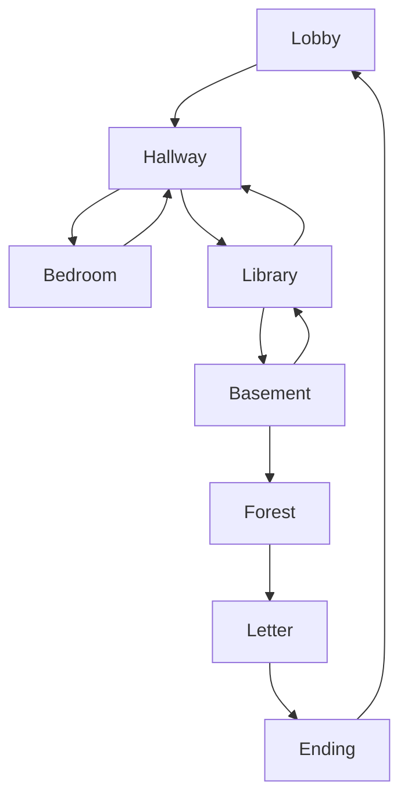

# Game Off 2026 - PUZZLE FLOW

- Versión 0.4 - Ruta implementada en `0.1.1-proto`
- Creado: 03/11/2026
- Actualizado: 23/11/2026

---

Este documento describe la progresión jugable real. Las propuestas antiguas de
reloj global, generador, fusible o habitación ritual no forman parte del MVP.

## 1. Ruta principal

Bedroom y Library son ramas conectadas desde Hallway. Sus objetos permiten
avanzar de forma cruzada hasta la Library y el Basement.

## 2. Controles

- Clic izquierdo: interactuar, recoger, usar, cambiar de room o avanzar.
- Clic derecho: examinar sin ejecutar la acción del interactable.
- SHIFT / botón HUD: cambiar de realidad.
- F / icono de Linterna: encender o apagar la Linterna en el Basement.
- Enter / Space / Escape / Continue: avanzar la carta o su presentación.
- Restart: restablecer estado y volver al Lobby.

## 3. Inventario principal

1. Llave del Personal.
2. Llave de Library.
3. Libro Desgastado.
4. Disquete.
5. Código del Basement.
6. Manivela de la válvula.

La linterna obtenida en Bedroom se refleja en el HUD. El Bloque 5 la convierte
en una herramienta activa solo dentro del Basement: se puede apagar o encender
desde su icono o con `F`, sin batería ni consumo. Fuera del Basement se desactiva
automáticamente.

## 4. Cadena de puzles

### Puzzle 1 - Acceso al Hallway

- Room: Lobby.
- Problema: la puerta interior está cerrada.
- Solución: recoger la Llave del Personal y usarla en la puerta.
- Recompensa: acceso al Hallway.

### Puzzle 2 - Primer SHIFT

- Room: Hallway.
- Problema: el obstáculo bloquea la lectura y el tránsito normal.
- Solución: usar SHIFT o el botón del HUD para entrar en Other Side.
- Regla: SHIFT también funciona en Bedroom, Library y Basement, pero no en Lobby
  ni Forest.

### Puzzle 3 - Llave de Library

- Room: Bedroom.
- Problema: la puerta de Library está bloqueada.
- Solución: encender la luz, cambiar a Other Side, abrir el armario y recoger la
  llave sin la amenaza del monstruo.
- Recompensa: acceso a Library.

### Puzzle 4 - Libro, disquete y ordenador

- Rooms: Library y Bedroom.
- Problema: el acceso al Basement requiere un código.
- Solución:
  1. obtener el Worn Book en Library;
  2. resolver la lectura que revela el Floppy Disk;
  3. encender la torre del ordenador en Bedroom;
  4. insertar el disquete y consultar el monitor;
  5. obtener el Basement Code.
- Recompensa: el código puede consumirse en el panel de Library.

### Puzzle 5 - Estantería y Basement

- Room: Library.
- Problema: la puerta del Basement está oculta y el panel requiere el código.
- Solución: activar la estantería, revelar la puerta y usar el código en Other Side.
- Recompensa: acceso persistente al Basement.

### Puzzle 6 - Presión y negación

- Room: Basement.
- Secuencia:
  1. encender la linterna;
  2. examinar la caja de efectos personales;
  3. obtener la manivela;
  4. instalarla en la válvula en Realidad Normal;
  5. activar el vapor;
  6. cambiar a Other Side y rechazar la manifestación;
  7. volver a Normal para usar la salida al Forest.
- Sin linterna activa, los objetos clave muestran feedback oscuro y no consumen
  items ni activan flags.
- Recompensa: acceso terminal al Forest.

### Puzzle 7 - Forest y carta

- Room: Forest.
- Solución: avanzar por las profundidades 0-6.
- Resultado final: aparece Table + Ceiling Light + Revelation Letter.
- La carta conduce directamente al final; no hay retorno al Basement.

## 5. Memorias opcionales

Las Memorias no bloquean el recorrido. Se descubren al examinar:

| Memoria | Room | Punto | Realidad |
| --- | --- | --- | --- |
| 01 | Lobby | Family Picture | Normal u Other Side |
| 02 | Hallway | Ammonite Stain | Other Side |
| 03 | Bedroom | Closed Window | Other Side |
| 04 | Library | Broken Wall Clock | Other Side |
| 05 | Basement | Toolbox | Other Side |

Cada flag puede activarse una sola vez. El contador solo aparece al final.

## 6. Finales

| Memorias | Final |
| --- | --- |
| 0-2 | Bad Ending - Denial |
| 3-4 | Neutral Ending - Escape |
| 5 | True Ending - Reunion |

Después del resumen, Restart restablece flags, inventario, Forest y room activa,
cerrando los overlays antes de volver al Lobby.

## 7. Validación Sprint 4

El loop debe superar la misma matriz en Editor, WebGL y Windows. Las tareas de
playtest, builds e itch.io están en
[MVP-Sprint-4.md](../../02-Technical-Design/MVP-Sprint-4.md).
