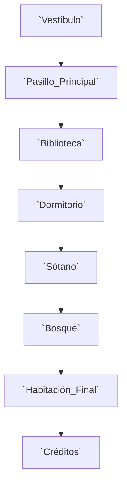

# Game Off 2026 - PUZZLE FLOW

- Versión 0.2 - Estructura de Progresión
- Creado: 03/11/2026
- Actualizado: 05/11/2026

---

Este documento define el flujo principal de juego a partir de los sistemas establecidos en el GDD, especialmente la mecánica SHIFT, el sistema temporal y los estados de objetos.

## 1. Localización

El juego tiene lugar en un antiguo sanatorio abandonado.

Tras un incidente desconocido, el lugar existe simultáneamente en dos versiones de la realidad:

- La Realidad Normal.
- El Otro Lado.

A medida que el jugador explora el edificio, descubrirá que ambos mundos comparten elementos, pero presentan diferencias que alteran rutas, objetos y eventos.

---

## 2. Escenarios principales

### 1. Vestíbulo - Lobby

- Punto inicial.
- Estado general:
  - Zona segura.
  - Introducción narrativa.
  - Aprendizaje de exploración e interacción.
- Conexiones:
  - `Pasillo Principal` - `Hallway`.

### 2. Pasillo Principal - Hallway

Primera zona donde se introduce SHIFT.

- Estado general:
  - Ruta parcialmente bloqueada (block-obstacle) por un obstáculo visible.
  - Introducción clara a la diferencia entre realidades.
  - El espacio mantiene la misma composición básica, pero cambia su legibilidad y accesibilidad.
  - El icono del Amuleto se activa (parpadea) para indicar disponibilidad de SHIFT.
- Conexiones:
  - `Biblioteca` - `Library`.
  - `Dormitorio` - `Bedroom`.
- Objetivo de diseño:
  - enseñar que la exploración no es lineal ni segura;
  - mostrar un bloqueo que requiere manipular la realidad;
  - activar la mecánica SHIFT como herramienta principal;
  - preparar la sensación de progresión hacia zonas de mayor densidad narrativa.
- Referencia visual: [Visual-Room-Hallway.md](./Visual-Room-Hallway.md)
- Referencia mecánica: [SHIFT-Mechanic.md](./SHIFT-Mechanic.md)

### 3. Biblioteca - Library

Zona orientada a la obtención de información.

- Estado general:
  - Documentación.
  - Pistas.
  - Primeros eventos opcionales.
- Conexiones:
  - `Pasillo Principal` - `Hallway`.
  - `Sótano` - `Basement`.

### 4. Dormitorio - Bedroom

Zona orientada al uso de estados de objetos.

- Estado general:
  - Objetos dañados.
  - Información personal.
  - Recursos narrativos.
  - Encuentro de la `Linterna`
  - Primara amenaza del monstruo visible en el Otro Lado.
- Conexiones:
  - `Pasillo Principal` - `Hallway`.

### 5. Sótano - Basement

Centro mecánico del edificio.

- Estado general:
  - Generador.
  - Instalaciones.
  - Eventos temporales.
  - Uso de la `Linterna`
- Conexiones:
  - `Biblioteca` - `Library`.
  - `Bosque` - `Forest`.

### 6. Bosque - Forest

Zona final.

- Estado general:
  - Avance hacia las luces.
  - Convergencia narrativa y resolución del misterio principal.
- Conexiones:
  - `Sótano` - `Basement`.
  - `Habitación Final` - `Ending`.

---

## 3. Objetos clave

- Objetos principales
  1. Llave del Personal
  2. Libro de Registro
  3. Fotografía Antigua
  4. Código de Seguridad
  5. Fusible
  6. Llave del Sótano
  7. Código del Bosque
  8. Diario Fragmentado
- Objetos opcionales:
  9. Nota Médica
  10. Grabación Antigua
  11. Llave Oxidada
- Total estimado: 8-11 objetos.

---

## 4. Cadena principal de puzles

### PUZLE 1 - Acceso al Pasillo

- Escenario: Vestíbulo
- Problema: La puerta interior está cerrada.
- Solución: Encontrar la Llave del Personal.
- Enseña:
  - Examinar.
  - Recoger objetos.
  - Uso básico del inventario.
- Recompensa:
  - Acceso al `Pasillo Principal`.

### PUZLE 2 - Primer SHIFT

- Escenario: `Pasillo Principal`.
- Problema: Una estantería bloquea la ruta.
- Realidad Normal: La estantería está presente.
- El Otro Lado: La estantería no existe.
- Solución: Utilizar SHIFT para atravesar la zona.
  - El icono del Amuleto en la UI parpadea indicando disponibilidad.
  - El jugador puede hacer click en el icono o presionar LEFT SHIFT.
  - Para detalles de la mecánica, ver [SHIFT-Mechanic.md](./SHIFT-Mechanic.md).
- Enseña:
  - Mecánica SHIFT (introducción principal).
  - Estados Presente / Ausente.
  - Interacción mediante UI y teclado.
- Recompensa: Acceso a la `Biblioteca`.

### PUZLE 3 - Información Oculta

- Escenario: `Biblioteca`.
- Problema: Una cerradura requiere un código.
- Realidad Normal: Se encuentra un libro aparentemente normal.
- El Otro Lado: El contenido revela símbolos ocultos.
- Solución: Interpretar la pista para obtener el Código de Seguridad.
- Enseña:
  - Información diferente según la realidad.
  - Observación.
- Recompensa: Acceso al `Dormitorio`.

### PUZLE 4 - Estado de Objetos

- Escenario: `Dormitorio`.
- Problema: Una caja fuerte permanece cerrada.
- Realidad Normal: La caja está intacta.
- El Otro Lado: La caja está dañada.
- Solución: Acceder a su contenido desde la realidad adecuada.
- Enseña:
  - Estados Intacto / Dañado.
- Recompensa: Obtención del Fusible.

### PUZLE 5 - Activación del Generador

- Recompensa: Acceso al `Bosque`.
- Problema: El edificio no tiene energía.
- Solución: Instalar el Fusible y activar el generador.
- Consecuencia:
  - Avanza el reloj.
  - Se activa un evento temporal.
  - Aparecen nuevas rutas.
- Enseña:
  - Sistema temporal.
  - Estados Activo / Inactivo.
- Recompensa: Acceso al Bosque.

### PUZLE 6 - Convergencia
- Escenario: `Bosque`.
- Problema: El protagonista necesita aceptar el recuerdo que ha evitado.
- Requiere:
- Las Memorias obtenidas durante la partida.
- Solución: Avanzar a través de los cinco niveles del bosque y entrar en la Habitación Final.
- Enseña:
- Lectura emocional del resultado.
- Evaluación narrativa de las Memorias.
- Recompensa: Encuentro final y desenlace.

---

## 5. Eventos opcionales

### Evento temporal

A una hora determinada aparece una manifestación en la Biblioteca.

### Evento de realidad

Un objeto oculto únicamente puede encontrarse en El Otro Lado.

### Evento de decisión

El jugador puede ignorar o investigar una presencia observada anteriormente.

---

## 6. Finales

### Final Malo - Negación

El jugador escapa sin descubrir la verdad.

- Condición:
  - Obtener 0-2 Memorias.

### Final Neutral - Escapatoria

El jugador comprende parcialmente lo ocurrido.

- Condición:
  - Obtener 3-4 Memorias.

### Final Verdadero - La Verdad

El jugador reconstruye completamente los acontecimientos.

- Condición:
  - Obtener las 5 Memorias.
  - Completar el recorrido del Bosque y aceptar la verdad.

## 7. Resumen de progresión

Este flujo aprovecha directamente los sistemas definidos en el GDD: exploración, SHIFT, estados de objetos, eventos temporales y terror psicológico, manteniendo un alcance razonable para un desarrollo individual durante la Game Off 2026.
