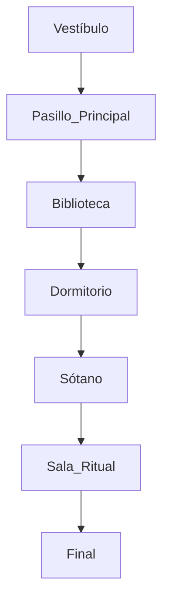

# Game Off 2026 - PUZZLE FLOW

- Versión 0.1 - Estructura de Progresión
- Creado: 03/11/2026
- Actualizado: 03/11/2026

---

Este documento define el flujo principal de juego a partir de los sistemas establecidos en el GDD, especialmente la mecánica SHIFT, el sistema temporal y los estados de objetos. [GameOff26-GameIdea-1 | Word], [GameOff26-...dea-1-v3 1 | PDF]

## 1. Localización

El juego tiene lugar en un antiguo sanatorio abandonado.

Tras un incidente desconocido, el lugar existe simultáneamente en dos versiones de la realidad:

- La Realidad Normal.
- El Otro Lado.

A medida que el jugador explora el edificio, descubrirá que ambos mundos comparten elementos, pero presentan diferencias que alteran rutas, objetos y eventos. [GameOff26-GameIdea-1 | Word], [GameOff26-...dea-1-v3 1 | PDF]

---

## 2. Escenarios principales

### 1. Vestíbulo

- Punto inicial.
- Estado general:
  - Zona segura.
  - Introducción narrativa.
  - Aprendizaje de exploración e interacción.
- Conexiones:
  - Pasillo Principal.

### 2. Pasillo Principal

Primera zona donde se introduce SHIFT.

- Estado general:
  - Ruta parcialmente bloqueada.
  - Introducción a las diferencias entre realidades.
- Conexiones:
  - Biblioteca.
  - Dormitorio.

### 3. Biblioteca

Zona orientada a la obtención de información.

- Estado general:
  - Documentación.
  - Pistas.
  - Primeros eventos opcionales.
- Conexiones:
  - Pasillo Principal.
  - Sótano.

### 4. Dormitorio

Zona orientada al uso de estados de objetos.

- Estado general:
  - Objetos dañados.
  - Información personal.
  - Recursos narrativos.
- Conexiones:
  - Pasillo Principal.

### 5. Sótano

Centro mecánico del edificio.

- Estado general:
  - Generador.
  - Instalaciones.
  - Eventos temporales.
- Conexiones:
  - Biblioteca.
  - Sala Ritual.

### 6. Sala Ritual

Zona final.

- Estado general:
  - Convergencia de ambas realidades.
  - Resolución del misterio principal.
- Conexiones:
  - Sótano.
  - Final.

---

## 3. Objetos clave

- Objetos principales
  1. Llave del Personal
  2. Libro de Registro
  3. Fotografía Antigua
  4. Código de Seguridad
  5. Fusible
  6. Símbolo Ritual
  7. Medallón
  8. Diario Fragmentado
- Objetos opcionales:
  9. Nota Médica
  10. Grabación Antigua
  11. Llave Oxidada
- Total estimado: 8-11 objetos.

---

## 4. Cadena principal de puzles

### PUZLE 1 - Acceso al Pasillo

- Escenario: Vestíbulo
- Problema: La puerta interior está cerrada.
- Solución: Encontrar la Llave del Personal.
- Enseña:
  - Examinar.
  - Recoger objetos.
  - Uso básico del inventario.
- Recompensa:
  - Acceso al Pasillo Principal.

### PUZLE 2 - Primer SHIFT

- Escenario: Pasillo Principal.
- Problema: Una estantería bloquea la ruta.
- Realidad Normal: La estantería está presente.
- El Otro Lado: La estantería no existe.
- Solución: Utilizar SHIFT para atravesar la zona.
- Enseña:
  - Mecánica SHIFT.
  - Estados Presente / Ausente.
- Recompensa: Acceso a la Biblioteca.

### PUZLE 3 - Información Oculta

- Escenario: Biblioteca.
- Problema: Una cerradura requiere un código.
- Realidad Normal: Se encuentra un libro aparentemente normal.
- El Otro Lado: El contenido revela símbolos ocultos.
- Solución: Interpretar la pista para obtener el Código de Seguridad.
- Enseña:
  - Información diferente según la realidad.
  - Observación.
- Recompensa: Acceso al Dormitorio.

### PUZLE 4 - Estado de Objetos

- Escenario: Dormitorio.
- Problema: Una caja fuerte permanece cerrada.
- Realidad Normal: La caja está intacta.
- El Otro Lado: La caja está dañada.
- Solución: Acceder a su contenido desde la realidad adecuada.
- Enseña:
  - Estados Intacto / Dañado.
- Recompensa: Obtención del Fusible.

### PUZLE 5 - Activación del Generador

- Escenario: Sótano.
- Problema: El edificio no tiene energía.
- Solución: Instalar el Fusible y activar el generador.
- Consecuencia:
  - Avanza el reloj.
  - Se activa un evento temporal.
  - Aparecen nuevas rutas.
- Enseña:
  - Sistema temporal.
  - Estados Activo / Inactivo.
- Recompensa: Acceso a la Sala Ritual.

### PUZLE 6 - Convergencia

- Escenario: Sala Ritual.
- Problema: El ritual permanece incompleto.
- Requiere:
  - Fotografía Antigua.
  - Medallón.
  - Símbolo Ritual.
  - Información obtenida durante la exploración.
- Solución: Alternar entre ambas realidades para reconstruir los acontecimientos.
- Enseña:
  - Uso combinado de todos los sistemas.
- Recompensa: Acceso al final.

---

## 5. Eventos opcionales

### Evento temporal

A una hora determinada aparece una manifestación en la Biblioteca.

### Evento de realidad

Un objeto oculto únicamente puede encontrarse en El Otro Lado.

### Evento de decisión

El jugador puede ignorar o investigar una presencia observada anteriormente.

---

## 6. Finales

### Final Malo - Negación

El jugador escapa sin descubrir la verdad.

- Condición:
  - Resolver únicamente los puzles obligatorios.

### Final Neutral - Escapatoria

El jugador comprende parcialmente lo ocurrido.

- Condición:
  - Descubrir parte de los eventos opcionales.

### Final Verdadero - La Verdad

El jugador reconstruye completamente los acontecimientos.

- Condición:
  - Completar todos los eventos opcionales.
  - Encontrar todos los objetos clave.
  - Resolver el ritual final completo.

## 7. Resumen de progresión

Este flujo aprovecha directamente los sistemas definidos en el GDD: exploración, SHIFT, estados de objetos, eventos temporales y terror psicológico, manteniendo un alcance razonable para un desarrollo individual durante la Game Off 2026. [GameOff26-GameIdea-1 | Word], [GameOff26-...dea-1-v3 1 | PDF]
