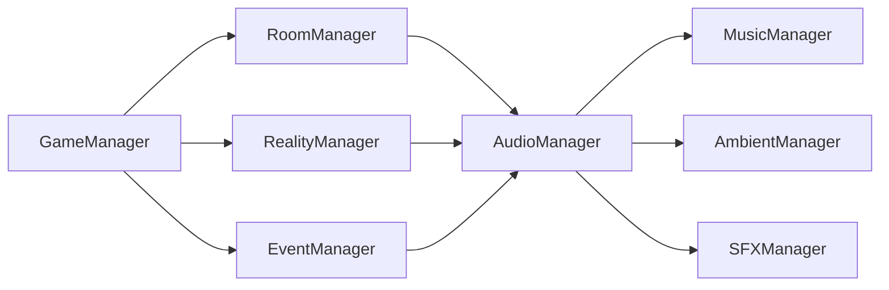

# Audio System Technical Design

- **Autor:** @LAS1819
- **Versión:** 1.1
- **Fecha:** 2026-11-09
- **Actualización:** 2026-11-10

## Resumen

El sistema de audio gestiona música, ambiente y SFX con una lógica simple, reutilizable y acoplada a los sistemas existentes del proyecto.

Su objetivo es reforzar la atmósfera, comunicar cambios entre realidades y acompañar la progresión emocional del juego, sin convertir el audio en un sistema independiente con demasiadas dependencias.

La base del proyecto ya está construida con managers de runtime y eventos; por eso la solución más sencilla es mantener ese mismo patrón y añadir un `AudioManager` como fachada central del sistema.

---

## Objetivos del sistema

- Reproducir música principal con transiciones suaves.
- Reproducir ambiente por sala y por realidad.
- Reproducir SFX para interacciones, eventos y feedback.
- Mantener un control centralizado de volumen y mezcla.
- Reutilizar contenido entre realidades sin duplicar lógica.
- Evitar acoplamientos con la lógica de gameplay.

---

## Principios de diseño

1. El audio debe ser un sistema más del runtime, no un sistema autónomo.
2. El resto del juego no debe tocar `AudioSource` directamente.
3. La fuente de verdad debe ser el estado del juego: sala, realidad y flags.
4. La música y el ambiente deben responder a eventos y a estado, no a decisiones ad hoc por escena.
5. La diferencia entre realidades debe venir de mezcla, filtros, volumen, crossfades y reutilización del contenido, no de duplicar todo.

---

## Arquitectura recomendada

El proyecto actual ya usa un patrón de managers gestionados por `GameManager` y observables por eventos. La propuesta más limpia es:

- `GameManager` mantiene el runtime y crea los sistemas.
- `AudioManager` actúa como fachada pública del sistema de audio.
- `MusicManager` gestiona la música principal.
- `AmbientManager` gestiona ambiente por sala y realidad.
- `SFXManager` gestiona efectos transitorios.

### Relación con el sistema de sistemas actual



El punto importante es que el audio observa el estado del juego y responde a él, pero no conoce internamente la lógica de puzzles, inventario o interacciones.

---

## Responsabilidades por manager

### AudioManager

- Punto de entrada público del sistema.
- Se subscribe a `RoomChanged`, `RealityChanged` y cambios de flags.
- Decide cuándo reproducir música, ambiente o SFX.
- Centraliza volumen maestro, mezcla y transiciones.

### MusicManager

- Reproduce la música base.
- Gestiona fader, crossfade y versiones por realidad.
- Mantiene un hilo musical coherente con la narrativa.

### AmbientManager

- Reproduce capas ambientales según la sala actual.
- Ajusta los materiales sonoros por realidad.
- Controla ecos y variaciones sin romper la continuidad.

### SFXManager

- Reproduce acciones cortas: pickup, door open, shift, feedback, etc.
- Evita saturar la escena con demasiados `AudioSource`.
- Debe priorizar efectos importantes con ducking o mezcla temporal.

---

## Integración con los sistemas actuales

La comunicación debe ser por eventos y lectura de estado, no por referencias directas.

### Eventos recomendados

- `RoomManager.RoomChanged` → cambia ambiente según la sala actual.
- `RealityManager.RealityChanged` → cambia mezcla de música y ambiente.
- `GameManager.FlagChanged` → dispara SFX o cues narrativas según el estado del mundo.
- `InteractionManager` / `EventManager` → resumen de interacciones relevantes para audio.

### Regla de aislamiento

- El audio no debe mirar internamente el estado de inventario ni de salas a lo bruto.
- El gameplay no debe hacer llamadas directas a `AudioSource` o a `MusicManager`.
- El único punto de acceso debe ser `AudioManager` o eventos de audio.

---

## Señales de diseño para la mezcla sonora

### Música

- Debe funcionar como hilo narrativo.
- Debe evitar cambios bruscos entre salas y realidades.
- Debe apoyarse en transiciones de 0,5 a 8 segundos según la importancia.
- La versión de la otra realidad debe reutilizar la misma base musical cuando sea posible.

### Ambiente

- Debe reforzar la identidad de la sala.
- Debe ser modulable por realidad y por capa.
- Debe funcionar como soporte, no como elemento destacado que compita con la música.

### SFX

- Deben ser cortos, claros y muy legibles.
- Deben reforzar feedback inmediato.
- Deben ser independiente del contenido musical principal.

---

## Reglas de mezcla y transición

- Fade In / Fade Out obligatorio para música y ambiente.
- Ducking de música cuando un SFX importante o un evento narrativo tiene prioridad.
- Los cambios entre realidades deben ser suaves y perceptibles, no bruscos.
- El nivel de detalle del audio debe depender del estado: menú, juego, transición, final narrativo.

### Valores recomendados

- Música fade in: 0,5 - 2 s
- Música fade out: 2 - 8 s
- Ambiente fade in: 1 - 4 s
- Ambiente fade out: 2 - 8 s
- SFX fade: 0,1 - 0,5 s

---

## Formatos y pipeline

### Música / Ambiente

- Formato final: MP3, 192 kbps
- Objetivo: mantener tamaño razonable y coherencia estilística.

### SFX

- Formato final: OGG
- Objetivo: mejor respuesta para sonidos cortos y menor artefacto de compresión.

### Pipeline de exportación

1. Generación en WAV desde Sonic Pi.
2. Edición en Audacity.
3. Eliminación de silencios.
4. Ajuste de inicio y fin.
5. Fade In / Fade Out.
6. Normalización.
7. Exportación final en MP3 o OGG.

### Normalización

- Meta recomendada: -3 dB
- Objetivo: mantener coherencia entre pistas y margen para mezcla final.

---

## Importación en Unity

La importación debe dejarse con ajustes que favorezcan la estabilidad del juego y la sensación de continuidad musical.

La versión exacta de la interfaz de Unity puede variar según la versión del editor, pero el patrón de trabajo es siempre el mismo. Lo importante es mantener un preset consistente para cada tipo de audio:

### Preset recomendado

#### Música y ambiente (clips largos)

- `Load Type`: `Streaming`
- `Preload Audio Data`: `false`
- `Spatial Blend`: `0` (2D)
- `Force To Mono`: `false` salvo que haga falta ahorrar memoria adicional
- `Compression Format`: la opción disponible según el archivo y la versión de Unity (`Vorbis`, `PCM`, `ADPCM`, o el codec del propio archivo si aparece). Lo importante es que la música larga no se cargue completa de golpe.

Motivo: las pistas largas no deben cargarse de una vez en memoria si queremos evitar cortes o picos al entrar a la escena. Con streaming, el audio se consume durante la reproducción y resulta más estable para un tema principal.

#### SFX (clips cortos)

- `Load Type`: `Decompress On Load`
- `Preload Audio Data`: `true`
- `Spatial Blend`: `0` en la mayoría de los casos; solo activar 3D si el sonido realmente necesita dirección.
- `Compression Format`: `Vorbis` o `PCM` según el archivo y el balance entre calidad y tamaño; para SFX cortos, `Vorbis` suele ser la opción más equilibrada.

Esto hace que los SFX sean rápidos y fiables, algo importante cuando aparecen varios eventos seguidos.

### Regla práctica para la Jam

- Música larga -> `Streaming` siempre.
- SFX cortos -> `Decompress On Load` y `Vorbis` o `PCM` según lo que convenga.
- Música principal -> 2D por defecto y `loop = true`.

No hace falta obsesionarse con el nombre exacto de cada opción del importador; lo importante es respetar el patrón y dejarlo consistente en todos los archivos.

---

## Audio Mixer: guía rápida y útil para la Jam

El `Audio Mixer` no es complicado y sí vale la pena para este proyecto. En una jam, no hace falta un sistema enorme; con 3-4 grupos ya es suficiente.

### Estructura recomendada

Crear un `Audio Mixer` con estos grupos:

- `Master`
  - `Music`
  - `Ambient`
  - `SFX`

Esto permite controlar el volumen total y separar claramente los canales sin tocar el contenido.

### Cómo hacerlo en Unity

1. Crear un `Audio Mixer` en `Assets > Create > Audio Mixer`.
2. Abrir el mixer y crear grupos:
   - `Master`
   - `Music`
   - `Ambient`
   - `SFX`
3. `Music`, `Ambient` y `SFX` deben quedar como subgrupos de `Master`.
4. En cada `AudioSource`, asignar el `Output` al grupo correspondiente.
5. Ajustar `Volume` por grupo según la mezcla final.

### Para este proyecto

- `Music` debe llevar el tema principal y el tema dinámico.
- `Ambient` debe llevar capas ambientales y room ambiences.
- `SFX` debe llevar pickup, puertas, shift, feedback y eventos puntuales.

Esto facilita el ducking: por ejemplo, cuando suena un SFX importante, la música puede bajar un poco sin que haya que tocar el clip individual.

### ¿Es complicado?

No para este proyecto: es un setup rápido, de 5 a 10 minutos si está bien organizado. No es sobreingeniería, y sí ayuda mucho a la mezcla y a la legibilidad del audio.

La recomendación es hacerlo, porque además encaja muy bien con el patrón de managers del proyecto: el `AudioManager` decide qué clip tocar, y el `Audio Mixer` decide cómo se mezcla desde la salida final.

### Importante: ¿qué se ve en el mixer?

El mixer no es un espectro gráfico. Lo normal es ver un nivel de salida (VU/medidor de volumen) por grupo, no una onda o un espectro visual. Si el `AudioSource` no está conectado al grupo correcto mediante `outputAudioMixerGroup`, no verás actividad en `Music` aunque el audio esté sonando.

Para que el grupo `Music` muestre movimiento:

1. Crear un `Audio Mixer` y un grupo `Music`.
2. En el `AudioSource` de la música, asignar `Output` al grupo `Music`.
3. Reproducir el tema y comprobar que el medidor del bus cambia.

Si se quiere ver un espectro real de frecuencias, eso ya requiere un visualizador FFT o un plugin específico; no es lo que muestra el mixer por defecto.

---

## Datos y contenido

La solución más simple y reutilizable es usar datos descriptivos en lugar de hardcodear clips.

### Elementos sugeridos

- `AudioCueSO`: representa una cue individual con clip, volumen, pitch, loop, fade, prioridad y máscara de realidad.
- `AudioRoomProfileSO`: representa el perfil sonoro de una sala.
- `AudioMixerGroup`: Master, Music, Ambient, SFX.

### Convenciones de naming

- `music_main_theme`
- `music_main_theme_other_side`
- `ambient_lobby_normal`
- `ambient_hallway_other_side`
- `sfx_key_pickup`
- `sfx_shift_transition`

Esto hace que el contenido sea reutilizable, legible y fácil de depurar.

---

## Organización de assets

```text
Assets/
  Audio/
    Music/
      ThemeFather.mp3
    Ambient/
    SFX/
    Mixers/
      Master.mixer
  Scripts/
    Audio/
      AudioManager.cs
      MusicManager.cs
      AmbientManager.cs
      SFXManager.cs
      AudioCueSO.cs
      AudioRoomProfileSO.cs
```

La clave no es la cantidad de archivos, sino mantener una estructura uniforme desde el principio.

---

## Jerarquía recomendada en Unity

Para una primera implementación clara y sin sobreingenierizar, basta con un GameObject raíz para el audio y dejar los subcomponentes organizados así:

```text
GameManager
├── AudioManager (AudioManager)
│   ├── MusicManager (MusicManager)
│   ├── AmbientManager (AmbientManager) [si se necesita]
│   └── SFXManager (SFXManager) [si se necesita]
├── RoomManager
├── RealityManager
├── EventManager
└── UIManager
```

### Recomendación práctica

- `AudioManager` debe ir como hijo del `GameManager`, porque la lógica de runtime ya está habitualmente controlada por ese root.
- `MusicManager` debe tener un `AudioSource` propio en el mismo GameObject o como child.
- `AmbientManager` y `SFXManager` pueden empezar como simples componentes con sus propios `AudioSource` cuando haga falta, pero no es obligatorio desde el inicio.
- El audio no va a la escena de juego como objeto “suelto”; va a vivir dentro de esta estructura para que quede controlado desde el mismo sistema de sistemas del proyecto.

### Configuración mínima por objeto

- `MusicManager`
  - `AudioSource` attached
  - `themeFatherClip` serializado
  - `loop = true`
  - `normalVolume = 0.80`
  - `otherSideVolume = 0.90`
  - `normalPitch = 1f`
  - `otherSidePitch = 1.08f`

- `AudioManager`
  - asigna la referencia de la clip al `MusicManager`
  - se suscribe a eventos del sistema
  - se deja como root de audio del runtime

Esto es suficiente para el MVP y mantiene la escena limpia.

---

## Reglas operativas del MVP

Para no complicar la implementación y mantener un proyecto viable:

- Empezar con `AudioManager`, `MusicManager` y `SFXManager`.
- Dejar `AmbientManager` como capa auxiliar si la sala necesita un tratamiento extra.
- Usar `AudioCueSO` para casi todo el contenido.
- Mantener un número limitado de cues: 3-4 de música y 5-8 de SFX.
- Priorizar una mezcla clara por realidad antes que una infraestructura gigantesca.

---

## Recomendación final

La solución más sensata para este proyecto es:

- mantener el patrón actual de managers,
- centralizar la lógica en `AudioManager`,
- usar eventos para comunicar cambios,
- y mantener la música/ambiente como capas modales,
- mientras los SFX son eventos transitorios.

Esto encaja mejor con la arquitectura actual, conserva la simplicidad necesaria para una game jam y mantiene una base escalable sin sobreingenierizar.

Si más adelante el proyecto crece, siempre se puede ampliar con perfiles por sala, mezclas más complejas, capas de ambiente y más eventos narrativos. Pero no hace falta implementar todo eso desde el inicio.

---

## Cierre

Este documento queda como una versión sintetizada y útil: clara, compacta y alineada con la realidad del proyecto.

La idea central no cambia: el audio debe actuar como un servicio del juego, observado por el estado del mundo y gestionado por una única fachada central, sin romper la simplicidad del sistema de sistemas que ya existe.
