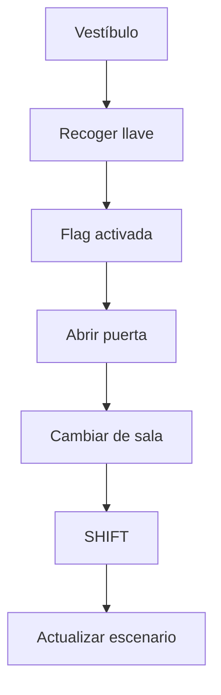

# Game Off 2026 - TECHNICAL DESIGN

- **Versión:** 0.1
- **Creación:** 03/11/2026
- **Última actualización:** 03/11/2026

---

## 1. Objetivo técnico

El proyecto se construirá mediante sistemas genéricos basados en datos.

La lógica específica de puzles, habitaciones y eventos deberá configurarse mediante datos y no mediante código específico para cada caso.

- **Objetivos:**
  - Reducir código repetido.
  - Facilitar la creación de contenido.
  - Simplificar el mantenimiento.
  - Permitir construir el juego completo reutilizando los mismos sistemas. [GameOff26-GameIdea-1 | Word], [GameOff26-...zleFlow-v1 | Word]

---

## 2. Arquitectura principal

El juego se divide en cuatro sistemas principales:

```plaintext
Room System
Reality System
Interaction System
Inventory System
```

Y dos sistemas secundarios:

```plaintext
Event System
Save System
```

---

## 3. Managers

### GameManager

- Responsabilidades:
  - Inicialización global.
  - Referencias generales.
  - Estado general del juego.

Singleton.

### RoomManager

- **Responsabilidades:**
  - Cargar habitaciones.
  - Cambiar habitaciones.
  - Gestionar elementos presentes en cada sala.

### RealityManager

- **Responsabilidades:**
  - Controlar la realidad activa.
- **Estados:**
  - Normal
  - OtherSide
- **Funciones:**
  - SwitchReality()
  - SetReality()

### InventoryManager

- **Responsabilidades:**
  - Añadir objetos.
  - Eliminar objetos.
  - Consultar objetos disponibles.

### InteractionManager

- **Responsabilidades:**
  - Detectar interacción.
  - Resolver acciones.
  - Lanzar resultados.

### EventManager

- **Responsabilidades:**
  - Escuchar eventos.
  - Activar contenido opcional.
  - Evaluar condiciones.

---

## 4. Sistema de habitaciones

Cada habitación se define mediante un RoomData.

### RoomData

```plaintext
string id
Sprite normalBackground
Sprite otherSideBackground
List<InteractableData>
List<RoomConnection>
```

Ejemplo:

```plaintext
Vestibulo
Pasillo
Biblioteca
Dormitorio
Sotano
SalaRitual
```

[GameOff26-...zleFlow-v1 | Word], [GameOff26-GameIdea-1 | Word]

---

## 5. Sistema de realidad

### RealityType

```plaintext
Normal
OtherSide
```

El sistema debe permitir: SwitchReality()

Cuando ocurre:

- cambia fondo.
- actualiza interactivos.
- lanza efectos visuales.
- actualiza estados visibles.
[GameOff26-GameIdea-1 | Word], [GameOff26-...l-Guide-v1 | Word]

---

## 6. Sistema de objetos

### InventoryItemData

```plaintext
string id
string displayName
Sprite icon
string description
```

Ejemplos:

```plaintext
StaffKey
Fuse
Medallion
Photo
```

[GameOff26-...zleFlow-v1 | Word]

---

## 7. Sistema de interactivos

### InteractableData

```plaintext
string id
string displayName
bool visibleNormal
bool visibleOtherSide
InteractionType interactionType
string requiredItem
string resultFlag
```

### InteractionType

```plaintext
Examine
Pickup
Use
Transition
```

[GameOff26-GameIdea-1 | Word]

---

## 8. Sistema de Flags

Toda la progresión debe depender de Flags.

### GameFlag

```plaintext
HasStaffKey
DoorOpened
FoundCode
HasFuse
GeneratorEnabled
RitualCompleted
```

Los puzles nunca consultan objetos directamente.

Consultarían:

- HasFlag()
- SetFlag()

---

## 9. Sistema de eventos

### EventData

```plaintext
string id
List<GameFlag>
RealityType
Action
```

Ejemplos:

```plaintext
LibraryGhost
HiddenItem
SecretEnding
```

[GameOff26-GameIdea-1 | Word], [GameOff26-...zleFlow-v1 | Word]

---

## 10. MVP

El MVP técnico debe permitir:



Cuando eso funcione:

✅ Arquitectura validada.
✅ Vertical Slice posible.
✅ Riesgo técnico principal eliminado.

---
